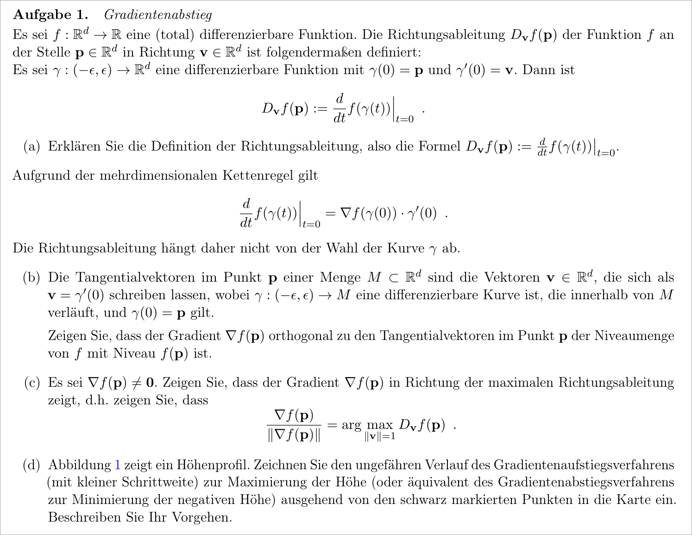
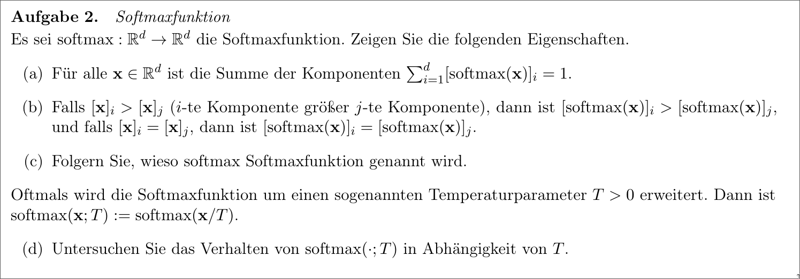
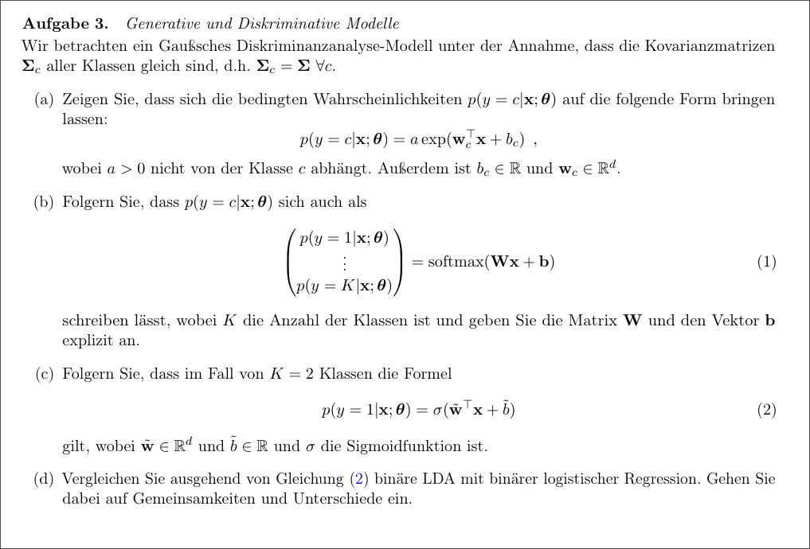

### 1a)

### 1b)

### 1c)

### 1d)

## Definition

Softmax function is defined as follows,

$\text{softmax}: \mathbb{R}^d \to \mathbb{R}^d$ for aribitrary $\bf{x} \in \mathbb{R}^d$ with $\bf{x} := \begin{pmatrix} x_1 \\ \vdots \\ x_d \end{pmatrix}$

$$
\text{softmax}(\bf{x}) := \begin{pmatrix} \dfrac{\exp(x_1)}{\sum_{i = 1}^{d} \exp(x_i)} \\ \\ \vdots \\ \\ \dfrac{\exp(x_d)}{\sum_{i = 1}^{d} \exp(x_i)} \end{pmatrix} = \dfrac{1}{\sum_{i = 1}^{d} \exp(x_i)} \begin{pmatrix} \exp(x_1) \\ \vdots \\ \exp(x_d) \end{pmatrix}
$$

**NOTE** the softmax function always returns a vector with positive values for all $\bf{x}\in\mathbb{R}^d$ since $\exp(b) > 0$ for any $b \in\mathbb{R}$

### 2a) Show $\sum_{i = 1}^{d} [\text{softmax(x)}]_i = 1$

From above definition we have,

$$
[\text{softmax}(x)]_i = \dfrac{\exp(x_i)}{\sum_{j = 1}^{d} \exp(x_i)}
$$

Substituting this in the sum we get,

$$
\begin{align*}
\sum_{i = 1}^{d} [\text{softmax(x)}]_i &= \sum_{i = 1}^{d} \dfrac{\exp(x_i)}{\sum_{j = 1}^{d} \exp(x_i)} \\\\

&= \dfrac{\sum_{i = 1}^{d} \exp(x_i)}{\sum_{j = 1}^{d} \exp(x_i)} \\\\

&= 1
\end{align*}
$$

### 2b) Show the following$

i) $[\text{softmax(x)}]_i > [\text{softmax(x)}]_j$ if $x_i > x_j$ 

Assume $x_i > x_j$ and for sake of contradiction $[\text{softmax(x)}]_i \leq [\text{softmax(x)}]_j$ then,

$\dfrac{\exp(x_i)}{\sum_{k = 1}^{d} \exp(x_k)} \leq  \dfrac{\exp(x_j)}{\sum_{k = 1}^{d} \exp(x_k)}$

$\iff \ln \left( \dfrac{\exp(x_i)}{\sum_{k = 1}^{d} \exp(x_k)} \right) \leq \ln \left( \dfrac{\exp(x_i)}{\sum_{k = 1}^{d} \exp(x_k)} \right)$

$\iff \ln(\exp(x_i)) - \ln\left(\sum_{k = 1}^{d} \exp(x_k)) \right) \leq \ln(\exp(x_j)) - \ln\left(\sum_{k = 1}^{d} \exp(x_k)) \right)$

$\iff x_i - \ln\left(\sum_{k = 1}^{d} \exp(x_k)) \right) \leq x_j - \ln\left(\sum_{k = 1}^{d} \exp(x_k)) \right)$

$\iff x_i \leq x_j$

Which contradicts the assumption that $x_i > x_j$

ii) $[\text{softmax(x)}]_i = [\text{softmax(x)}]_j$ if $x_i = x_j$

Same as (i), Assume $x_i = x_j$ and for sake of contradiction $[\text{softmax(x)}]_i \neq [\text{softmax(x)}]_j$ then,

$\dfrac{\exp(x_i)}{\sum_{k = 1}^{d} \exp(x_k)} \neq  \dfrac{\exp(x_j)}{\sum_{k = 1}^{d} \exp(x_k)}$

$\iff \ln \left( \dfrac{\exp(x_i)}{\sum_{k = 1}^{d} \exp(x_k)} \right) \neq \ln \left( \dfrac{\exp(x_i)}{\sum_{k = 1}^{d} \exp(x_k)} \right)$

$\iff \ln(\exp(x_i)) - \ln\left(\sum_{k = 1}^{d} \exp(x_k)) \right) \neq \ln(\exp(x_j)) - \ln\left(\sum_{k = 1}^{d} \exp(x_k)) \right)$

$\iff x_i - \ln\left(\sum_{k = 1}^{d} \exp(x_k)) \right) \neq x_j - \ln\left(\sum_{k = 1}^{d} \exp(x_k)) \right)$

$\iff x_i \neq x_j$

Which contradicts the assumption that $x_i = x_j$

### 2c) Why "softmax"?

The largest element in the input vector remains the largest element after the softmax function is applied to the vector, hence the "max" part. The "soft" signifies that the function keeps information about the other, non-maximal elements in a reversible way (as opposed to a "hardmax", which is just the standard maximum function).

https://math.stackexchange.com/questions/1888141/why-is-the-softmax-function-called-that-way

### 2d)

### 3a) Show $p(y = c \mid x,\theta) = a\exp(\bf{w_c}^T\bf{x} + b_c)$

GDA uses Bayes rule. So we have,

$$
p(y = c \mid x,\theta) = \frac{p(x \mid y = c, \theta) \cdot p(y = c \mid \theta)}{\sum_{c'} p(x \mid y = c', \theta)\cdot p(y = c' \mid \theta)}
$$

where, $p(x \mid y = c, \theta) = \mathcal{N}(x \mid \mu_c,\Sigma_c)$ according to the GDA assumption and also let $p(y = c \mid \theta) = \pi_c$

then we have,

$\iff p(y = c \mid \mathbf{x},\theta) = \dfrac{\mathcal{N}(\mathbf{x} \mid \mu_c,\Sigma) \cdot \pi_c}{p(\mathbf{x})}$

$= \dfrac{\pi_c}{p(\mathbf{x})} \cdot \mathcal{N}(\mathbf{x} \mid \mu_c,\Sigma)$

$= \dfrac{\pi_c}{p(\mathbf{x})} \cdot \dfrac{1}{\sqrt{(2\pi)^d\det(\Sigma)}}\cdot\exp\left(-\dfrac{(\mathbf{x} - \mu_c)^T \Sigma^{-1} (\mathbf{x} - \mu_c)}{2}\right)$

$= \exp\left[ \ln\left( \dfrac{\pi_c}{p(\mathbf{x})} \right) \right] \cdot \dfrac{1}{\sqrt{(2\pi)^d\det(\Sigma)}}\cdot\exp\left(-\dfrac{(\mathbf{x} - \mu_c)^T \Sigma^{-1} (\mathbf{x} - \mu_c)}{2}\right)$

$= \dfrac{1}{\sqrt{(2\pi)^d\det(\Sigma)}}\cdot\exp\left[ -\dfrac{(\mathbf{x} - \mu_c)^T \Sigma^{-1} (\mathbf{x} - \mu_c)}{2} + \ln\left( \dfrac{\pi_c}{p(\mathbf{x})} \right)\right]$

$= \dfrac{1}{\sqrt{(2\pi)^d\det(\Sigma)}}\cdot\exp\left[ -\dfrac{(\mathbf{x}^T - \mu_c^T) \Sigma^{-1} (\mathbf{x} - \mu_c)}{2} + \ln\left( \dfrac{\pi_c}{p(\mathbf{x})} \right)\right]$

$= \dfrac{1}{\sqrt{(2\pi)^d\det(\Sigma)}}\cdot\exp\left[ -\dfrac{(\mathbf{x}^T \Sigma^{-1} - \mu_c^T \Sigma^{-1}) (\mathbf{x} - \mu_c)}{2} + \ln\left( \dfrac{\pi_c}{p(\mathbf{x})} \right)\right]$

$= \dfrac{1}{\sqrt{(2\pi)^d\det(\Sigma)}}\cdot\exp\left[ -\dfrac{(\mathbf{x}^T\Sigma^{-1}\mathbf{x} - \mathbf{x}^T\Sigma^{-1}\mu_c - \mu_c^T\Sigma^{-1}\mathbf{x} + \mu_c^T\Sigma^{-1}\mu_c)}{2} + \ln\left( \dfrac{\pi_c}{p(\mathbf{x})} \right)\right]$

$= \dfrac{1}{\sqrt{(2\pi)^d\det(\Sigma)}}\cdot\exp\left[ \dfrac{-\mathbf{x}^T\Sigma^{-1}\mathbf{x} + \mathbf{x}^T\Sigma^{-1}\mu_c + \mu_c^T\Sigma^{-1}\mathbf{x} - \mu_c^T\Sigma^{-1}\mu_c}{2} + \ln(\pi_c) - \ln(p(\mathbf{x})) \right]$

$= \dfrac{1}{\sqrt{(2\pi)^d\det(\Sigma)}}\cdot\exp\left[ \dfrac{-\mathbf{x}^T\Sigma^{-1}\mathbf{x}}{2} + \dfrac{\mathbf{x}^T\Sigma^{-1}\mu_c + \mu_c^T\Sigma^{-1}\mathbf{x} - \mu_c^T\Sigma^{-1}\mu_c}{2} + \ln(\pi_c) - \ln(p(\mathbf{x})) \right]$

$= \dfrac{1}{\sqrt{(2\pi)^d\det(\Sigma)}}\cdot\exp\left[ \dfrac{-\mathbf{x}^T\Sigma^{-1}\mathbf{x}}{2} - \ln(p(\mathbf{x}))  + \dfrac{\mathbf{x}^T\Sigma^{-1}\mu_c + \mu_c^T\Sigma^{-1}\mathbf{x} - \mu_c^T\Sigma^{-1}\mu_c}{2} + \ln(\pi_c) \right]$

$= \dfrac{1}{\sqrt{(2\pi)^d\det(\Sigma)}}\cdot \exp\left[ -\left( \dfrac{\mathbf{x}^T\Sigma^{-1}\mathbf{x}}{2} + \ln(p(\mathbf{x})) \right) \right] \cdot\exp\left[ \dfrac{\mathbf{x}^T\Sigma^{-1}\mu_c + \mu_c^T\Sigma^{-1}\mathbf{x} - \mu_c^T\Sigma^{-1}\mu_c}{2} + \ln(\pi_c)\right]$

Since $\Sigma^{-1}$ is symmetric, i.e, $\Sigma^{-T} = \Sigma^{-1}$ we have,

$= \dfrac{1}{\sqrt{(2\pi)^d\det(\Sigma)}}\cdot \exp\left[ -\left( \dfrac{\mathbf{x}^T\Sigma^{-1}\mathbf{x}}{2} + \ln(p(\mathbf{x})) \right) \right] \cdot\exp\left[ \dfrac{2\mu_c^T\Sigma^{-1} \mathbf{x} - \mu_c^T\Sigma^{-1}\mu_c}{2} + \ln(\pi_c)\right]$

$= \dfrac{1}{\sqrt{(2\pi)^d\det(\Sigma)}}\cdot \exp\left[ -\left( \dfrac{\mathbf{x}^T\Sigma^{-1}\mathbf{x}}{2} + \ln(p(\mathbf{x})) \right) \right] \cdot\exp\left[ \dfrac{2\mu_c^T\Sigma^{-1} \mathbf{x}}{2} - \dfrac{\mu_c^T\Sigma^{-1}\mu_c}{2} + \ln(\pi_c)\right]$

$= \underbrace{\dfrac{1}{\sqrt{(2\pi)^d\det(\Sigma)}}\cdot \exp\left[ -\left( \dfrac{\mathbf{x}^T\Sigma^{-1}\mathbf{x}}{2} + \ln(p(\mathbf{x})) \right) \right]}_{a} \cdot\exp\left[ {\underbrace{[\Sigma^{-1}\mu_c]}_{\mathbf{w}_c}}^T \cdot \mathbf{x} + \underbrace{\ln(\pi_c) - \dfrac{\mu_c^T\Sigma^{-1}\mu_c}{2}}_{b_c} \right]$

Since $\forall y\in\mathbb{R}^+\ \dfrac{1}{\sqrt{y}} > 0$ and $\forall y\in\mathbb{R}\ \exp(y) > 0$, and $\det(\Sigma) > 0$ since the joint covariance matrix is positive semi-definite and invertible, therefore we have $a > 0$

Furthermore, $a$ does not depend on $c$: the normalizing constant $\dfrac{1}{\sqrt{(2\pi)^d\det(\Sigma)}}$ and the term $\exp\left(-\dfrac{\mathbf{x}^T\Sigma^{-1}\mathbf{x}}{2}\right)$ contain only $\mathbf{x}$ and the shared covariance matrix $\Sigma$ (since $\Sigma_c = \Sigma$ for all $c$), and $p(\mathbf{x}) = \sum_{c'} \pi_{c'}\,\mathcal{N}(\mathbf{x} \mid \mu_{c'}, \Sigma)$ is a sum over all classes rather than a quantity of one specific class.

### 3b) 

From (3a), we have,

$p(y = c \mid \mathbf{x}; \theta) = \underbrace{\dfrac{1}{\sqrt{(2\pi)^d\det(\Sigma)}}\cdot \exp\left[ -\left( \dfrac{\mathbf{x}^T\Sigma^{-1}\mathbf{x}}{2} + \ln(p(\mathbf{x})) \right) \right]}_{a} \cdot\exp\left[ {\underbrace{[\Sigma^{-1}\mu_c]}_{\mathbf{w}_c}}^T \cdot \mathbf{x} + \underbrace{\ln(\pi_c) - \dfrac{\mu_c^T\Sigma^{-1}\mu_c}{2}}_{b_c} \right]$

$\iff p(y = c \mid \mathbf{x}; \theta) = a \cdot\exp\left[ \mathbf{w}_c^T \cdot \mathbf{x} + b_c \right]$

From sum rule of probabilities, we have,

$\sum_{c'} a \cdot\exp[\mathbf{w}_{c'}^T \cdot \mathbf{x} + b_{c'}] = 1$

$\iff a\cdot \sum_{c'} \exp[ \mathbf{w}_{c'}^T \cdot \mathbf{x} + b_{c'}] = 1$

$\iff a = \dfrac{1}{\sum_{c'} \exp[ \mathbf{w}_{c'}^T \cdot \mathbf{x} + b_{c'}]}$

So writing the whole vector, we have,

$\begin{pmatrix} p(y = 1 \mid \mathbf{x}; \theta) \\ \\ \vdots \\ \\ p(y = K \mid \mathbf{x}; \theta) \end{pmatrix} = \begin{pmatrix} a \cdot\exp[\mathbf{w}_{1}^T \cdot \mathbf{x} + b_{1}] \\ \\ \vdots \\ \\ a \cdot\exp[\mathbf{w}_{K}^T \cdot \mathbf{x} + b_{K}] \end{pmatrix}$

factoring out $a$, we have,

$= a \cdot \begin{pmatrix} \exp[\mathbf{w}_{1}^T \cdot \mathbf{x} + b_{1}] \\ \\ \vdots \\ \\ \exp[\mathbf{w}_{K}^T \cdot \mathbf{x} + b_{K}] \end{pmatrix}$

$= \dfrac{1}{\sum_{c'} \exp[ \mathbf{w}_{c'}^T \cdot \mathbf{x} + b_{c'}]} \cdot \begin{pmatrix} \exp[\mathbf{w}_{1}^T \cdot \mathbf{x} + b_{1}] \\ \\ \vdots \\ \\ \exp[\mathbf{w}_{K}^T \cdot \mathbf{x} + b_{K}] \end{pmatrix}$

Now we define,

$W := \begin{pmatrix} \mathbf{w}_1^T \\ \vdots \\ \mathbf{w}_K^T \end{pmatrix}$

$\mathbf{b} := \begin{pmatrix} b_1 \\ \vdots \\ b_K \end{pmatrix}$

Since the $c$-th entry of $W\mathbf{x}$ is the $c$-th row of $W$ times $\mathbf{x}$, we have,

$W\mathbf{x} + \mathbf{b} = \begin{pmatrix} \mathbf{w}_1^T\mathbf{x} + b_1 \\ \vdots \\ \mathbf{w}_K^T\mathbf{x} + b_K \end{pmatrix}, \quad \text{i.e.} \quad (W\mathbf{x} + \mathbf{b})_c = \mathbf{w}_c^T\mathbf{x} + b_c$

With the softmax function $\text{softmax}(\mathbf{z}) = \dfrac{1}{\sum_{c'} \exp(z_{c'})} \begin{pmatrix} \exp(z_1) \\ \vdots \\ \exp(z_K) \end{pmatrix}$ for $\mathbf{z} \in \mathbb{R}^K$, setting $\mathbf{z} = W\mathbf{x} + \mathbf{b}$ gives

$\begin{pmatrix} p(y = 1 \mid \mathbf{x}; \theta) \\ \vdots \\ p(y = K \mid \mathbf{x}; \theta) \end{pmatrix} = \text{softmax}(W\mathbf{x} + \mathbf{b})$

### 3c)

Setting $K = 2$, we have,

$\begin{pmatrix} p(y = 1 \mid \mathbf{x}; \theta) \\ p(y = 2 \mid \mathbf{x}; \theta) \end{pmatrix} = \text{softmax}(W\mathbf{x} + \mathbf{b})$

$= \dfrac{1}{\sum_{c'} \exp[ \mathbf{w}_{c'}^T \cdot \mathbf{x} + b_{c'}]} \cdot \begin{pmatrix} \exp[\mathbf{w}_1^T \cdot \mathbf{x} + b_1] \\ \exp[\mathbf{w}_2^T \cdot \mathbf{x} + b_2] \end{pmatrix}$

So, $p(y = 1 \mid \mathbf{x}; \theta) = \dfrac{1}{\sum_{c'} \exp[ \mathbf{w}_{c'}^T \cdot \mathbf{x} + b_{c'}]} \cdot \exp[\mathbf{w_1^Tx} + b_1]$

$= \dfrac{\exp[\mathbf{w_1^Tx} + b_1]}{\exp[\mathbf{w_1^Tx} + b_1] + \exp[\mathbf{w_2^Tx} + b_2]}$

$= \dfrac{1}{\dfrac{\exp[\mathbf{w_1^Tx} + b_1] + \exp[\mathbf{w_2^Tx} + b_2]}{\exp[\mathbf{w_1^Tx} + b_1]}}$

$= \dfrac{1}{\dfrac{\exp[\mathbf{w_1^Tx} + b_1]}{\exp[\mathbf{w_1^Tx} + b_1]} + \dfrac{\exp[\mathbf{w_2^Tx} + b_2]}{\exp[\mathbf{w_1^Tx} + b_1]}}$

$= \dfrac{1}{1 + \dfrac{\exp[\mathbf{w_2^Tx} + b_2]}{\exp[\mathbf{w_1^Tx} + b_1]}}$

$= \dfrac{1}{1 + \exp[\mathbf{(w_2 - w_1)^Tx} + (b_2 - b_1)]}$

$= \dfrac{1}{1 + \exp[- (\mathbf{(w_1 - w_2)^Tx} + (b_1 - b_2))]}$

$= \sigma(\tilde{\mathbf{w}}^T\mathbf{x} + \tilde{b})$, where $\tilde{\mathbf{w}} = \mathbf{(w_1 - w_2)}$ and $\tilde{b} = (b_1 - b_2)$

### 3d)